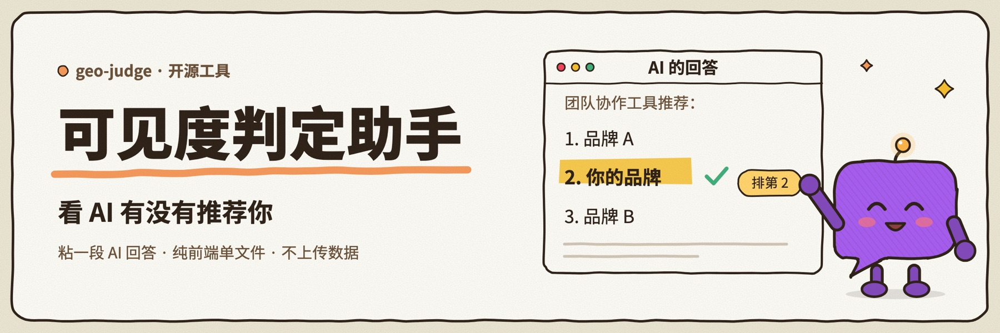
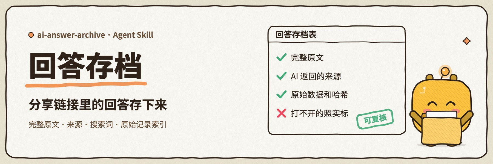
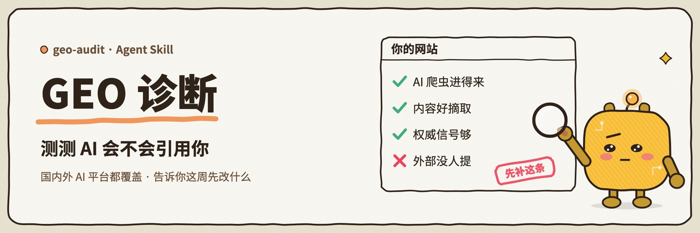
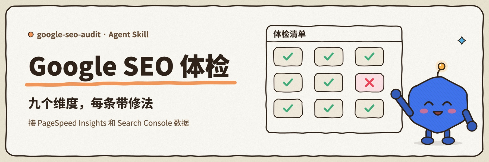
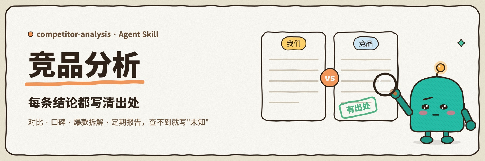
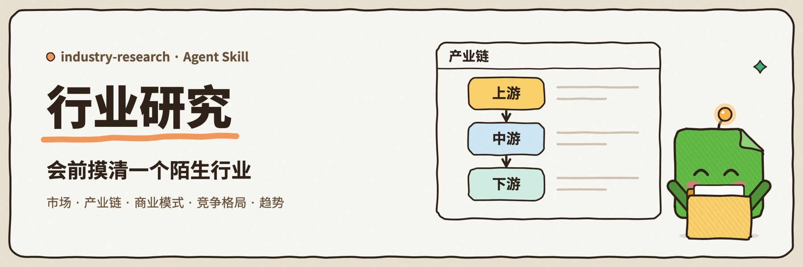
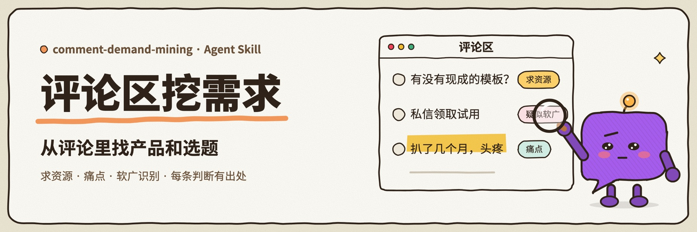
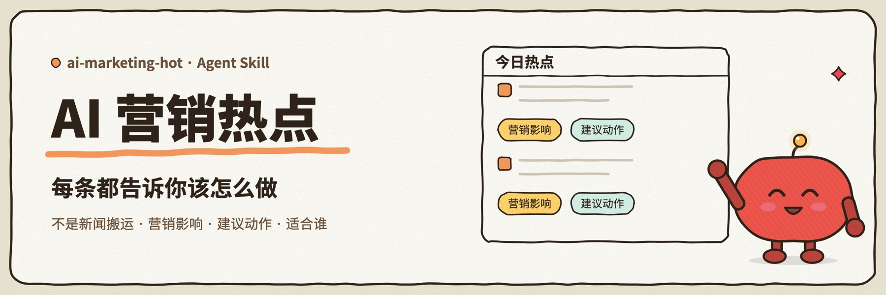
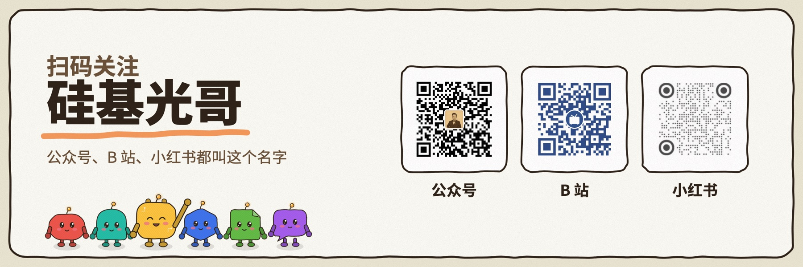

## 你好，我是硅基光哥

做 AI 营销增长。帮已有官网、产品或内容基础的个人品牌、B2B 小团队和出海企业，解决官网获客、GEO / AI 搜索、内容增长和 AI 工作流的问题。

这里开源的是我自己每天在用的营销工具和 Agent Skills。小红书 1.7 万+ 垂直粉丝，全网 3 万+；[AI Marketing Lift](https://aimarketinglift.com) 上有 100+ 篇实战文章、142 个术语词条和 9 个免费工具，一个人从零搭起来并持续维护。

## 最近在做：GEO 可见度判定助手

在 ChatGPT、豆包、DeepSeek 这些 AI 里问一个客户会问的问题，把回答粘进来，就知道你的品牌是被正文点名、只被引用，还是根本没出现。纯前端单文件，不上传任何数据。

[在线用 →](https://aimarketinglift.com/tools/geo-judge) · [打开 geo-judge →](https://github.com/jiguang9/geo-judge) · [和 geo-audit 一起用](https://github.com/jiguang9/geo-judge#和-geo-audit-配合用)

刚开源，觉得有用的话，在仓库右上角点颗 Star。

配套的存档工具。一批豆包、ChatGPT、DeepSeek 分享链接进去，出来一张回答存档表：完整原文、AI 返回的来源、搜索词，原始数据另存一份。接上判定助手批量判，再合成一份能交付、能逐条复核的原始记录索引。 [打开 ai-answer-archive →](https://github.com/jiguang9/ai-answer-archive)

## 让 AI 和搜索引擎找到你

检查 AI 爬虫进不进得来、内容好不好被摘取、权威信号够不够，告诉你为什么没被引用、这周先改什么。国内外的 AI 平台都覆盖。 [打开 geo-audit →](https://github.com/jiguang9/geo-audit)

从技术 SEO、Core Web Vitals 到 Search Console 数据，每条结论都带证据和修法，查不到的标"未知"，不靠猜。 [打开 google-seo-audit →](https://github.com/jiguang9/google-seo-audit)

## 做市场研究、跟热点

竞品对比、口碑分析、竞品爆款拆解、定期竞品报告，每条重要结论都分清是事实、推断还是未知。 [打开 competitor-analysis →](https://github.com/jiguang9/competitor-analysis)

会前快速搞懂一个陌生行业：市场、产业链、商业模式、竞争格局和趋势，冲突的数字并列写出，不取平均。 [打开 industry-research →](https://github.com/jiguang9/industry-research)

把小红书等平台的帖子连评论区贴进来，看清用户卡在哪一步、现在怎么凑合、哪些是软广，产品机会分"直接做"和"先验证"，每条判断都能追回到具体评论。 [打开 comment-demand-mining →](https://github.com/jiguang9/comment-demand-mining)

聚合 AI 行业动态、营销平台官方消息和社区讨论，每条热点都写清营销影响、建议动作和适合谁。 [打开 ai-marketing-hot →](https://github.com/jiguang9/ai-marketing-hot)

这几个 Skill 都能装进 Claude Code、Codex、OpenClaw 和 Hermes Agent，安装方式见各自仓库；官网的 [Agent Skills 页](https://aimarketinglift.com/skills/)有每个 Skill 的使用说明。

## 关注硅基光哥

公众号、B 站、小红书都叫「硅基光哥」。手机上不方便扫码，可以直接点 [B 站](https://space.bilibili.com/433645514) · [小红书](https://www.xiaohongshu.com/user/profile/5b494c9e11be105e8fedaba0)，公众号在微信里搜「硅基光哥」。

[官网](https://aimarketinglift.com) · [服务合作](https://aimarketinglift.com/consulting) · [更多开源项目](https://github.com/jiguang9?tab=repositories)
